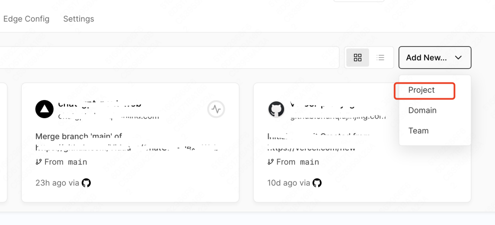
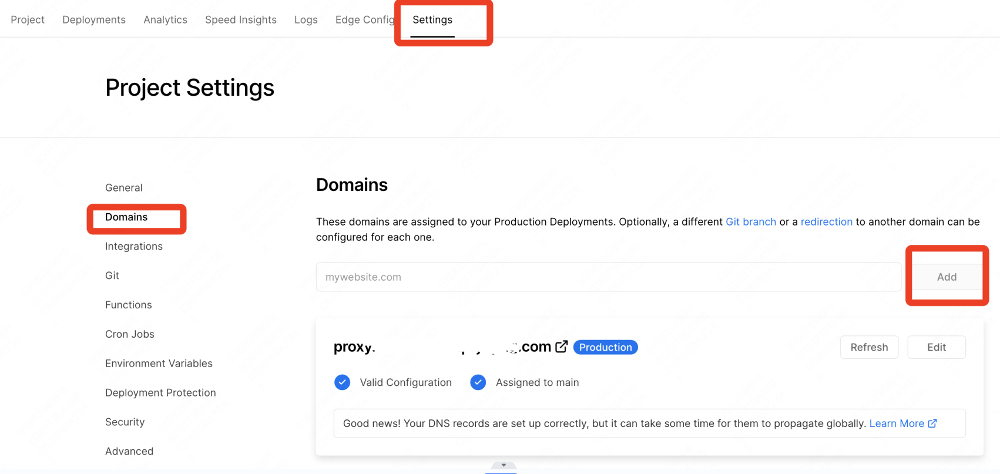

# Vercel API Proxy

[简体中文](./README.md)

A free reverse proxy on Vercel: add a prefix in front of any URL and access it through your own domain. Useful for giving APIs like OpenAI a different entry domain, or speeding up GitHub access and downloads.

## Features

- **Completely free** — runs on the Vercel free tier (100 GB/month)
- **Zero dependencies** — a static homepage, `vercel.json` rewrites, and one Edge Function; no build step
- **Two proxy modes** — direct (rewrite) and enhanced (Edge Function: follows 3xx redirects, adds CORS)
- **Light/dark homepage** — type a URL, get both proxy links at once

## Deploy

**Option 1: one-click (recommended)**

[](https://vercel.com/new/clone?repository-url=https://github.com/TrueHOOHA/vercel-api-proxy)

**Option 2: manual**

1. Fork this repository
2. Log in to [Vercel](https://vercel.com/), **New Project** → import your fork → **Deploy**

   

3. (Optional, recommended) Bind a custom domain — the default `.vercel.app` subdomain can be unstable in mainland China. Add a CNAME record at your registrar pointing to the address Vercel provides.

   

## Usage

Just add a prefix to any URL:

```
https://your-domain.com/https/target-URL            ← direct mode
https://your-domain.com/http/target-URL
https://your-domain.com/api/proxy/https/target-URL   ← enhanced mode
```

| Prefix | Maps to |
|--------|---------|
| `/https/target-URL` | `https://target-URL` |
| `/http/target-URL` | `http://target-URL` |
| `/api/proxy/https/target-URL` | `https://target-URL` (enhanced) |
| `/api/proxy/http/target-URL` | `http://target-URL` (enhanced) |

### Which mode to use

| Scenario | Use |
|----------|-----|
| Server-side API calls, large downloads | Direct `/https/...`: no function overhead, keeps `Content-Length` |
| Target returns 3xx redirects, or calling the proxy from browser JS | Enhanced `/api/proxy/...`: `Location` is rewritten back to proxy form (redirect chains stay on your domain); responses carry `Access-Control-Allow-Origin: *` |

> The enhanced mode buffers request bodies and drops `Content-Length`, and is subject to function execution limits — use the direct mode for large downloads. It also does not rewrite asset references inside proxied pages.

### Homepage

Visit your domain after deploying, type a full URL (with `http://` or `https://`), and both proxy links are generated at once — copy or open them directly.

## Examples

### 1. New entry domain for the OpenAI API

```python
openai.api_base = "https://your-domain.com/https/api.openai.com/v1"
```

### 2. GitHub acceleration

```text
https://github.com/TrueHOOHA/vercel-api-proxy
→ https://your-domain.com/https/github.com/TrueHOOHA/vercel-api-proxy
```

Release downloads (`github.com` 302s to `objects.githubusercontent.com`):

- Direct mode: proxy the final URL after the redirect — `https://your-domain.com/https/objects.githubusercontent.com/...`
- Enhanced mode: just proxy the original link, redirects are followed automatically —
  `https://your-domain.com/api/proxy/https/github.com/owner/repo/releases/download/v1.0/file.zip`

### 3. Google search (limits of page proxying)

```text
https://www.google.com/search?q=vercel-api-proxy
→ https://your-domain.com/https/www.google.com/search?q=vercel-api-proxy
```

> Page proxying only works for simple, text-only pages. Asset references inside the HTML (`/js/x.js` etc.) are not rewritten, so complex pages break — in both modes.

## How it works

- **Direct mode**: 4 rewrite rules in `vercel.json` restore the protocol segment from the path and forward the request; no functions involved
- **Enhanced mode**: `api/proxy/[...path].ts` (Edge Function) forwards the request, uses `redirect: 'manual'` to catch 3xx responses and rewrite `Location` back to proxy form, and adds CORS headers
- The homepage is a single `index.html` that only generates links

## Notes

1. **Traffic quota** — the Vercel free tier allows 100 GB/month; use it wisely
2. **Static assets** — asset paths inside proxied pages are not rewritten (see example 3)
3. **Compliance** — follow your local laws and the Vercel terms of service; use for legal purposes only

## Acknowledgements

Forked from [souying/vercel-api-proxy](https://github.com/souying/vercel-api-proxy), with the following changes:

- Fixed the homepage URL truncation bug (`split(':/')` dropped everything after a second `":/"`)
- Removed the never-working WSS rules and the `:protocol*` catch-all rules that rewrote arbitrary paths into invalid schemes
- Added enhanced mode (Edge Function: 3xx redirect following + CORS)
- Redesigned the homepage (Vercel style, auto light/dark, both links generated at once)

## License

For study and research purposes only.
